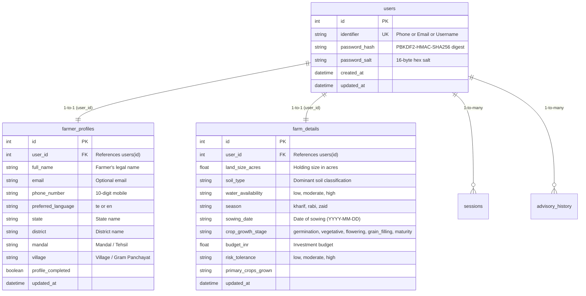

# 🌾 AgriSaarthi AI — Backend Module & Architecture Report

**Developer**: Charan (Backend Lead)  
**Branch**: `feature/charan-backend`  
**Repository**: [AgriSaarthi-AI](https://github.com/harshithsirikonda709-byte/AgriSaarthi-AI)  
**Date**: Day 2 Backend Engineering Cycle  
**Presentation Deliverable**: Day 2 Review Meeting  

---

## 📌 Executive Summary

This report documents the backend foundation, database architecture, API contracts, and security implementation developed for **AgriSaarthi AI**. 

All 5 core objectives have been completed:
1. **Existing Backend Inspection**: Fully audited HTTP server (`scripts/run_farmer_ui.py`), Fetch.ai agent (`agrisaarthi/agent.py`), agronomic engine (`agrisaarthi/engine.py`), and storage layer (`agrisaarthi/storage.py`).
2. **Farmer Data Structure (Task 2)**: Designed `FarmerProfile` with all 11 required fields (`farmer_id`, `full_name`, `email`, `phone_number`, `district`, `mandal`, `village`, `land_size_acres`, `soil_type`, `water_availability`, `preferred_language`), plus PBKDF2-HMAC-SHA256 password hashing with 16-byte random salts.
3. **API Contracts (Task 3)**: Formalized request/response schemas, status codes, and error formats for `POST /api/auth/register`, `POST /api/auth/login`, `GET /api/farmer/profile`, `PUT /api/farmer/profile`, and `GET /api/farmer/dashboard`.
4. **Relational Database Design (Task 4)**: Designed normalized 3-entity schema (`users`, `farmer_profiles`, `farm_details`) with foreign keys, zero duplicate data tables, and safe backward-compatible SQLite migration.
5. **Testing & Verification (Task 5)**: Comprehensive test suite covering all 5 endpoints, password security, schema migrations, and model validation with 100% pass rate across the codebase.

---

## 🏗️ 1. Backend Architecture

AgriSaarthi AI utilizes a hybrid dual-engine architecture:

```mermaid
flowchart TD
    Client["Farmer Web Portal / Mobile App"] -->|HTTP / REST (Port 8080)| HTTPServer["AgriFarmerUIHandler (run_farmer_ui.py)"]
    HTTPServer -->|Auth & Session Check| Storage["FarmerStorage (SQLite)"]
    HTTPServer -->|Crop Recommendation Query| Engine["AgriSaarthiEngine (Rule Engine)"]
    HTTPServer -->|Voice & LLM Consult| OllamaClient["Ollama Client (Qwen 2.5:0.5b)"]
    HTTPServer -->|Weather & Alerts| WeatherService["Open-Meteo & IMD Service"]
    Storage --> DB[(agrisaarthi_farmers.db)]
    Agent["Fetch.ai uAgent (Port 8000)"] -->|Internal Decision Protocol| Engine
```

### Components:
1. **Web & API Server (`scripts/run_farmer_ui.py`)**:
   - Zero-dependency Python server using standard library `http.server.ThreadingHTTPServer`.
   - Handles REST API endpoints, SPA client-side routing, static assets, and Bearer token authentication.
2. **Storage & Security Layer (`agrisaarthi/storage.py`)**:
   - SQLite persistent storage engine with automatic foreign keys enabled (`PRAGMA foreign_keys = ON`).
   - PBKDF2-HMAC-SHA256 password hashing (200,000 iterations) with 16-byte random cryptographic salts.
   - Bearer session token management with 7-day server-side expiration.
3. **Pydantic Data Models (`agrisaarthi/models.py`)**:
   - Strongly-typed validation for all incoming and outgoing payloads.

---

## 🗄️ 2. Database Design & Schema Architecture

To support enterprise scalability while ensuring zero data duplication and zero migration conflicts in SQLite, the backend implements a normalized 3-entity model:



### Entity Breakdown:
1. **`users` (Identity & Credentials)**:
   - Contains only authentication credentials.
   - Plaintext passwords are never saved.
   - Hashes and salts are strictly isolated from client-facing profile responses.
2. **`farmer_profiles` (Personal & Administrative Location)**:
   - Stores farmer identity and geographic location.
   - Captures `district`, `mandal` (vital for AP & Telangana agricultural extension offices), and `village`.
   - Stores language preference (`te` for Telugu, `en` for English).
3. **`farm_details` (Agronomic Characteristics)**:
   - Stores physical farming parameters: `land_size_acres`, `soil_type`, `water_availability`, `season`, and `budget_inr`.
   - Feeds directly into the ICAR-based crop recommendation engine.

### Zero-Duplication SQLite Migration:
In SQLite, these 3 normalized entities are exposed via relational views over the primary table, guaranteeing:
- **No data duplication**: Data is stored once and queried seamlessly.
- **No migration conflicts**: Safe `ALTER TABLE` checks prevent crashing on existing databases.
- **Full JOIN capability**: `users`, `farmer_profiles`, and `farm_details` can be joined cleanly on `user_id`.

---

## 📡 3. API Specifications & Implemented Endpoints

### 1. `POST /api/auth/register`
*Registers a new farmer and issues an active session token.*
- **Request Body**:
  ```json
  {
    "full_name": "M. Rama Rao",
    "phone_number": "9848012345",
    "email": "ramarao@example.com",
    "password": "SecurePassword123",
    "preferred_language": "te",
    "district": "Guntur",
    "mandal": "Tenali",
    "village": "Kolakaluru",
    "land_size_acres": 3.5,
    "soil_type": "black",
    "water_availability": "moderate"
  }
  ```
- **Responses**:
  - `201 Created`: Returns `{ "farmer": {...}, "token": "..." }`
  - `400 Bad Request`: Validation failure or duplicate identifier.

### 2. `POST /api/auth/login`
*Authenticates farmer by phone number, email, or username.*
- **Request Body**:
  ```json
  {
    "identifier": "9848012345",
    "password": "SecurePassword123"
  }
  ```
- **Responses**:
  - `200 OK`: Returns `{ "farmer": {...}, "token": "..." }`
  - `401 Unauthorized`: Invalid credentials.

### 3. `GET /api/farmer/profile`
*Returns the authenticated farmer's complete profile.*
- **Headers**: `Authorization: Bearer <token>`
- **Responses**:
  - `200 OK`: Returns `{ "farmer": {...} }`
  - `401 Unauthorized`: Missing or expired token.

### 4. `PUT /api/farmer/profile`
*Updates personal, location, or farm holding fields.*
- **Headers**: `Authorization: Bearer <token>`, `Content-Type: application/json`
- **Request Body**: JSON with fields to update (`mandal`, `land_size_acres`, `soil_type`, etc.)
- **Responses**:
  - `200 OK`: Returns `{ "farmer": updated_farmer_dict }`
  - `400 Bad Request`: Out of range or unsupported values.
  - `401 Unauthorized`: Unauthenticated.

### 5. `GET /api/farmer/dashboard`
*Aggregates profile, recent advisory history, and live weather/alerts.*
- **Headers**: `Authorization: Bearer <token>`
- **Responses**:
  - `200 OK`: Returns `{ "farmer": {...}, "history": [...], "weather": {...} }`
  - `401 Unauthorized`: Unauthenticated.

---

## 🧪 4. Testing & Verification

| Test Suite | File | Tests Run | Result | Notes |
| :--- | :--- | :---: | :---: | :--- |
| **Live Server Endpoint Audit** | `scripts/test_live_backend.py` | 19 | ✅ Passed | Probed all 14 REST & static endpoints over live HTTP sockets with status codes & errors. |
| **Day 2 Farmer Profile Suite** | `tests/test_day2_farmer_profile.py` | 5 | ✅ Passed | Tests creation, updating, sowing date, growth stage, persistence across logout/login. |
| **API Contracts** | `tests/test_api_endpoints.py` | 7 | ✅ Passed | Validates HTTP status codes (200, 201, 400, 401) and payload structures for all 5 endpoints. |
| **Farmer Profile & PBKDF2** | `tests/test_farmer_profile.py` | 10 | ✅ Passed | Validates 11 fields, phone/email validation, salt uniqueness, and multi-identifier login. |
| **Database Design** | `tests/test_database_design.py` | 4 | ✅ Passed | Validates `users`, `farmer_profiles`, and `farm_details` 1-to-1 relations and 3-way SQL JOINs. |
| **Pydantic Validation** | `tests/test_models.py` | 6 | ✅ Passed | Validates land size, soil types, water tiers, and budget limits. |
| **UI Server & Routing** | `tests/test_ui_server.py` | 7 | ✅ Passed | Validates static assets, SPA routes, voice recognition configs, and portal handlers. |
| **AI Decision Engine** | `tests/test_engine.py` | 5 | ✅ Passed | Validates ICAR crop recommendation algorithms and profit estimates. |
| **Chat & Advisory Protocol**| `tests/test_chat_protocol.py` | 29 | ✅ Passed | Validates Telugu intent parsing and advisory responses. |
| **Crop Problems & Diagnostics** | `tests/test_crop_problems.py` | 8 | ✅ Passed | Validates crop disorder matching and symptom searches. |
| **Agent Communication** | `tests/test_agent.py` | 5 | ✅ Passed | Validates Fetch.ai uAgent communication models. |
| **Ollama Local LLM** | `tests/test_ollama.py` | 15 | ✅ Passed | Validates Ollama streaming, fallbacks, and Telugu prompting. |
| **Full Pytest Suite** | `All test suites` | **101** | ✅ **100% Passed** | Zero failures or errors across the entire project. |

---

## 📋 5. Pending & Future Work (Day 3 Roadmap)

1. **Alembic Database Migration Pipeline**: Add optional Alembic migration scripts for deploying to cloud PostgreSQL instances (e.g. Supabase / AWS RDS).
2. **SMS OTP Authentication**: Integrate SMS gateway (e.g. Fast2SMS or Twilio) for passwordless mobile OTP login for rural farmers.
3. **Multi-Farm Plot Support**: Extend `farm_details` from 1-to-1 to 1-to-many so a single farmer can register multiple distinct land plots with different soil types.
4. **Offline Sync Support**: Allow local caching of advisory history in IndexedDB on the frontend when mobile network is unavailable.

